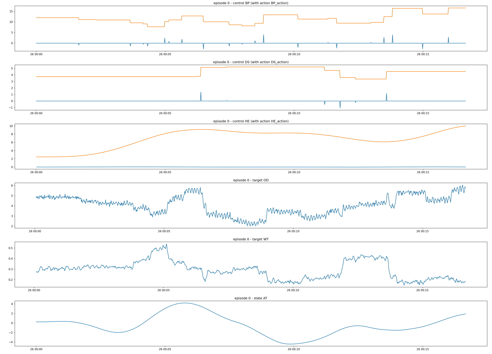

# Continuous Casting Benchmark

This benchmark is modeled to mimick certain characteristics of processes which we consider to be
typical for a large class of real world industrial control optimization RL problems.
As real process industry data usually cannot be published, we decided to create an
artificial dataset exhibiting important observed properties, to allow sharing of algorithm evaluations
on such problems.

When designing this benchmark, we chose channel number and characteristics according to a real-world
use case from the continuous casting domain, where the goal is to control a machine such that the
resulting product achieves desired product dimensions. The process serving as an example here is the
[Danner process glass tube drawing](https://en.wikipedia.org/wiki/Glass_tube). There the molten glass
mass wraps around a rotating ceramic cylinder and is pulled from it to form a glass tube. To prevent it
from collapsing, compressed air is blown through the hollow cylinder into the forming glass tube.

{ style="display:block; margin:0 auto; max-height: 500px; width: auto;" }

The available controls are *BP_action* (blow pressure action) and *DS_action* (drawing speed acton).
These are changes applied in each time step to the pressure applied during production
and the speed by which the glass tube is extracted from the machine; as a consequence, the
process should stay more or less stationary, if these actions are zero (depending on slow changes of
ambient channels which also influence the process). This pressure and speed have an influence on
the extracted product dimensions and properties, here represented by the target channels *OD* (outer diameter)
and *WT* (wall thickness).

An additional influence is modeled by the third and special control action/channel combination
*HE_action* (heat action) and resulting process heat *HE* applied. It does not directly influence the
product dimension but modulates the variance of an oscillating noise term on the *OD*. Where the *HE* is
large, the *OD* oscillates with relatively large amplitude around the mean determined by *BP* and *DS*.

Furthermore, an environmental influence is the external (room) temperature *AT* (ambient temperature),
which is not controllable but also has an influence on product dimensions/properties and has to be taken
into account when controlling the process. It is modeled as a strongly low-pass-filtered random walk and
does not change very quickly, though.

The most interesting properties can be summarized as follows:

- A realistic but manageable number of state, control and target channels
- Continuous state and action spaces
- Target channels are modeled to correspond to two product properties/dimensions, dubbed *OD* and *WT*
- Controls are similar to physical properties influencing the outcomes in the target channels, dubbed
  *BP*, *DS*, and *HE*. The actions taken into account by the environment are actually
  changes of the control channels and named *BP_action*, *DS_action*, and *HE_action*,
  respectively
- An additional state channel is *AT*, corresponding to an independent outside temperature
  (although varying more rapidly than to be expected in reality, to show interesting behavior in
  less amounts of data)
- This benchmark does not implement a real physical simulation, but models the state and target
  channels to show plausible behavior according to an imagined production process, by implementing
  mathematical formulas including filtered random walks/noise
- The reward is computed as the sum of negative absolute differences of target channel values from
  desired values ("setpoints", "goal values" or "objective values") for these. The setpoints are
  part of the observation (`desired_goal`) and can be configured as constant values or as schedules
  changing during an episode (see [Configuration](#configuration)), such that RL algorithms capable
  of using variable objectives can make use of these to tune policies to a current optimization goal
  (i.e. target values for *OD* and *WT*)
- A special dependency is that of *OD* on *HE*. The latter does not influence the expected (mean)
  value of *OD*, but a noisy sine-wave is overlaid on the raw *OD* value, whose amplitude is scaled
  according to the currently applied *HE*. Using appropriately low *HE*, a RL algorithm should be
  able to learn that this minimizes oscillations in *OD* and so indirectly allows a better control
  of this target.
- Time delays of target channel changes depending on control channel changes (adaptable in the
  configuration file, here specified for the provided `ccbench_default.yaml`):
    - *OD*: up to 11 time steps (for *BP*), and 9 (for *DS*), with a lag of 7 (for *BP*)
      and 5 (for *DS*)
    - *WT*: up to 14 time steps (for *BP*), and 11 (for *DS*), with a lag of 7 (for *BP*)
      and 4 (for *DS*)
    - Dependence on *HE* (only for *OD*) is immediate, but only only via the scaled sine wave
      described above
    - Dependence on *AT* is immediate
- The basic dependencies to be expected are that
    - an increase in *BP* should result in an increase in *OD* but a decrease in *WT*
    - an increase in *DS* should result in a decrease both in *OD* and in *WT*
    - *HE* only modulates the noise/oscillation on *OD*
    - *AT* has a positive effect on *OD*, but a negative effect on *WT*
- There are some limits applied in this process. The actions (changes per step) are limited to
    - *BP_action*: [ -4.0, 4.0 ]
    - *DS_action*: [ -3.0, 3.0 ]
    - *HE_action*: [ -0.1, 0.1 ]

  and the resulting control channel values are limited to
    - *BP*: [ 5.0, 30.0 ]
    - *DS*: [ 1.0, 12.0 ]
    - *HE*: [ 0.0, 15.0 ]
- Also, the state and target channels are limited (clipped) to
    - *OD*: [ 0.1, 15.0 ]
    - *WT*: [ 0.01, 1.2 ]
    - *AT*: [ -20.0, 40.0 ]
- In the modeled real process, the actions are very sparse, i.e. they are zero most of the time
  and the underlying control channel value is changed only seldomly, to adapt e.g. for changed
  environmental conditions, material characteristics, or desired product properties. Of course,
  a trained policy could apply non-zero actions each time step; but it will likely have to be
  cautious with these, as the process could get quickly out-of-hand, if delayed effects of
  actions in previous steps are not taken into account correctly.

The following graphs show an example episode of sampling this environment, where the actions (control
channel changes, in blue, while the actual control channel values are plotted in orange) have been
sampled randomly, but sparsely.



## Environment versions

Two versions of the environment are registered with Gymnasium; both use the same process model and
the default configuration file `resources/envs/ccbench/config/ccbench_default.yaml`:

| Behaviour | `CCBench-v1` (recommended, default of `CCBenchEnv`) | `CCBench-v0` (legacy API) |
|-----------|------------------------------------------------------|---------------------------|
| Reaching `episode_length` | `truncated=True` | `terminated=True` |
| Initial observation | finite, after hidden warm-up steps | target channels are NaN for the first steps |
| Temp channels (*wave*) | not observed | part of the observation |

```python
import gymnasium as gym
import ibs.envs  # registers the environments

env = gym.make("CCBench-v1", config_dict={"desired_goal": {"OD": 7.5}})
obs, info = env.reset(seed=42)
```

The environment never terminates on its own; `terminated` is only used by `CCBench-v0` for the time
limit. Observations are dicts with the keys `observation`, `achieved_goal` (target channels) and
`desired_goal` (setpoints), each mapping channel names to floats. Actions can be given as a dict
(all action channels) or as an array in the order of `env.unwrapped.action_control_map`.
Rendering is not supported (`render_mode` must be None).

Earlier versions of this package used the global `np.random` state and could not be seeded; data
generated with them cannot be reproduced with either version.

## Seeding and reproducibility

All random channel generators (random walks, noise, sparse actions, random initial control values)
draw from the environment's `np_random` generator; the global `np.random` state is not used.

- `reset(seed=s)` reseeds the environment and starts the episode at `start_timestamp`; the same
  seed, configuration and action sequence give an identical trajectory, independent of earlier
  episodes.
- `reset()` without seed continues the random number stream; the episode starts at midnight of the
  day after the last timestep of the previous episode.
- `reset(options={"episode_start": ...})` sets an explicit start timestamp (naive timestamps are
  interpreted as UTC).
- The `ExplorationAgent` (sparse random actions used by the data generator) takes a `seed` argument
  and can be reseeded with `agent.reset(seed=s)`. The data generator (`gen_industry_benchmarks
  ccbench`) derives the seeds of all episodes from the configured `seed`.

## Warm-up

Target channels depend on delayed control values, so their first values are undefined. With
`warmup_steps: "auto"` (default), `reset()` performs as many hidden zero-action steps as needed for a
finite initial observation (5 steps for the default configuration, at most 64). The warm-up steps
are not counted in the episode steps and are excluded from `env.unwrapped.get_episode_data()`
(unless `include_warmup=True`); `info["warmup_steps"]` reports their number. A fixed number of
warm-up steps can be configured as an integer, `0` disables the warm-up.

## Channels and units

The units are nominal labels for the synthetic process; they make the value ranges plausible but
the model is not a physical simulation. One step corresponds to `freq` (default one second).

| Channel | Semantics | Unit | Limits |
|---------|-----------|------|--------|
| *BP_action*, *DS_action*, *HE_action* | action | mbar/step, m/min/step, kW/step | see above |
| *BP* (blow pressure) | control | mbar | [ 5.0, 30.0 ] |
| *DS* (drawing speed) | control | m/min | [ 1.0, 12.0 ] |
| *HE* (heat) | control | kW | [ 0.0, 15.0 ] |
| *AT* (ambient temperature) | state | °C | [ -20.0, 40.0 ] |
| *OD* (outer diameter) | target | mm | [ 0.1, 15.0 ] |
| *WT* (wall thickness) | target | mm | [ 0.01, 1.2 ] |
| *wave* | temp (internal) | — | — |

`reset()` returns this information as `info["channels"]` (also available as
`env.unwrapped.channel_metadata`): semantics, limits, unit, step duration in seconds, the action
channel of each control channel and the reward type (`vop_type`) of each target channel. The info
of `step()` contains `step`, `timestamp` and `reward_terms` (reward contribution per target).

## Configuration

`gym.make(...)` and the factory `ibs.envs.ccbench.ccbench_env.create_ccbench_env` load the default
configuration file (or `config_file`) and recursively merge `config_dict` and further keyword
arguments into it: nested mappings are merged key by key, lists and other values are replaced and a
value of `None` removes a key. So single parameters can be changed without repeating the whole
channel specification, e.g. `config_dict={"process_spec": {"DS": {"cfa_init": 4.0}}}`. The merged
configuration is validated, and all detected problems are reported in one `ValueError`.

Environment settings:

| Key | Default | Meaning |
|-----|---------|---------|
| `episode_length` | 1000 | number of steps until the episode is truncated |
| `freq` | `1` | duration of one step: seconds or pandas offset string (e.g. `"1min"`) |
| `start_timestamp` | `"2000-01-01T00:00:00Z"` | start of seeded and first episodes |
| `truncate_on_time_limit` | `True` (v0: `False`) | report the time limit as truncated instead of terminated |
| `warmup_steps` | `"auto"` (v0: `0`) | hidden zero-action steps before the initial observation |
| `expose_temp_channels` | `False` (v0: `True`) | include temp channels in the observations |
| `desired_goal` | midpoint of the target limits | setpoint per target channel, see below |

Setpoints are configured per target channel as a value or as a schedule of `[step, value]` pairs,
starting at step 0 with strictly increasing steps; the last pair with `step` not after the current
episode step applies. They must lie within the target limits:

```yaml
desired_goal:
    OD: 7.5
    WT: [[0, 0.4], [500, 0.7]]
```

`reset(options={"desired_goal": {...}})` replaces the configured setpoints of the given targets for
one episode, `step(action, desired_goal={...})` sets them for the remaining episode.

Levers of the process specification (`process_spec.<channel>.<key>`) useful for varying the
operating scenario:

| Key | Channels | Meaning |
|-----|----------|---------|
| `cfa_init` | *BP*, *DS*, *HE* | initial control value, or range `[min, max]` for a random initial value |
| `limits` | all | value range of the channel (control and target values are clipped to it) |
| `rwo_offset`, `rwo_scales`, `rwo_decays` | *AT* | mean, step scale and decay of the ambient temperature random walk |
| `af_kernel` | *AT*, *OD*, *WT* | filter kernel (smoothing for *AT*, delay structure for the targets) |
| `wn_scale`, `wn_dist` | *OD*, *WT* | scale and distribution of the measurement noise |
| `vop_type` | *OD*, *WT* | reward type: `setpoint`, `upper_limit` or `lower_limit` |

String values of `fc_callback` and `af_kernel` are evaluated as Python expressions, so
configuration files are trusted code and must not come from untrusted sources.
