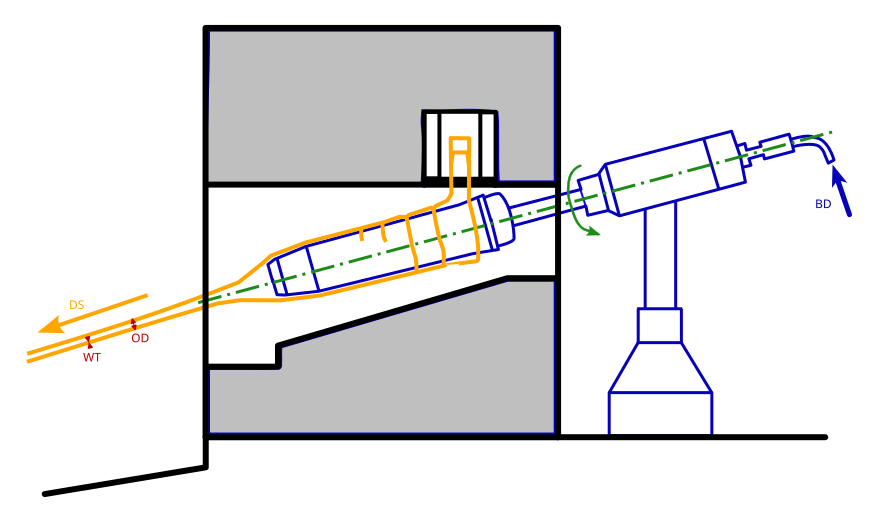

# Continuous Casting Benchmark

This benchmark is modeled to mimick certain characteristics of processes which we consider to be
typical for a large class of real world industrial control optimization RL problems.
As real process industry data usually cannot be published, we decided to create an
artificial dataset exhibiting important observed properties, to allow sharing of algorithm evaluations
on such problems.

When designing this benchmark, we chose channel number and characteristics according to a real-world
use case from the continuous casting domain, where the goal is to control a machine such that the
resulting product achieves desired product dimensions. The process serving as an example here is the
[Danner process glass tube drawing](https://en.wikipedia.org/wiki/Glass_tube). There the molten glass
mass wraps around a rotating ceramic cylinder and is pulled from it to form a glass tube. To prevent it
from collapsing, compressed air is blown through the hollow cylinder into the forming glass tube.

{ style="display:block; margin:0 auto; max-height: 500px; width: auto;" }

The available controls are *BP_action* (blow pressure action) and *DS_action* (drawing speed acton).
These are changes applied in each time step to the pressure applied during production
and the speed by which the glass tube is extracted from the machine; as a consequence, the
process should stay more or less stationary, if these actions are zero (depending on slow changes of
ambient channels which also influence the process). This pressure and speed have an influence on
the extracted product dimensions and properties, here represented by the target channels *OD* (outer diameter)
and *WT* (wall thickness).

An additional influence is modeled by the third and special control action/channel combination
*HE_action* (heat action) and resulting process heat *HE* applied. It does not directly influence the
product dimension but modulates the variance of an oscillating noise term on the *OD*. Where the *HE* is
large, the *OD* oscillates with relatively large amplitude around the mean determined by *BP* and *DS*.

Furthermore, an environmental influence is the external (room) temperature *AT* (ambient temperature),
which is not controllable but also has an influence on product dimensions/properties and has to be taken
into account when controlling the process. It is modeled as a strongly low-pass-filtered random walk and
does not change very quickly, though.

The most interesting properties can be summarized as follows:

- A realistic but manageable number of state, control and target channels
- Continuous state and action spaces
- Target channels are modeled to correspond to two product properties/dimensions, dubbed *OD* and *WT*
- Controls are similar to physical properties influencing the outcomes in the target channels, dubbed
  *BP*, *DS*, and *HE*. The actions taken into account by the environment are actually
  changes of the control channels and named *BP_action*, *DS_action*, and *HE_action*,
  respectively
- An additional state channel is *AT*, corresponding to an independent outside temperature
  (although varying more rapidly than to be expected in reality, to show interesting behavior in
  less amounts of data)
- This benchmark does not implement a real physical simulation, but models the state and target
  channels to show plausible behavior according to an imagined production process, by implementing
  mathematical formulas including filtered random walks/noise
- The reward is computed as the sum of negative absolute differences of target channel values from
  desired values ("setpoints", "goal values" or "objective values") for these. The setpoints are
  currently fixed, but in an extended version of this environment it is planned to expose these as
  additional inputs, such that RL algorithms capable of using variable objectives can make use of
  these to tune policies to a current optimization goal (i.e. target values for *OD* and *WT*)
- A special dependency is that of *OD* on *HE*. The latter does not influence the expected (mean)
  value of *OD*, but a noisy sine-wave is overlaid on the raw *OD* value, whose amplitude is scaled
  according to the currently applied *HE*. Using appropriately low *HE*, a RL algorithm should be
  able to learn that this minimizes oscillations in *OD* and so indirectly allows a better control
  of this target.
- Time delays of target channel changes depending on control channel changes (adaptable in the
  configuration file, here specified for the provided `ccbench_default.yaml`):
    - *OD*: up to 11 time steps (for *BP*), and 9 (for *DS*), with a lag of 7 (for *BP*)
      and 5 (for *DS*)
    - *WT*: up to 14 time steps (for *BP*), and 11 (for *DS*), with a lag of 7 (for *BP*)
      and 4 (for *DS*)
    - Dependence on *HE* (only for *OD*) is immediate, but only only via the scaled sine wave
      described above
    - Dependence on *AT* is immediate
- The basic dependencies to be expected are that
    - an increase in *BP* should result in an increase in *OD* but a decrease in *WT*
    - an increase in *DS* should result in a decrease both in *OD* and in *WT*
    - *HE* only modulates the noise/oscillation on *OD*
    - *AT* has a positive effect on *OD*, but a negative effect on *WT*
- There are some limits applied in this process. The actions themselves do not have a limit, but
  the resulting control channel values are limited to
    - *BP*: [ 5.0, 30.0 ]
    - *DS*: [ 1.0, 12.0 ]
    - *HE*: [ 0.0, 15.0 ]
- Also, the state and target channels are limited (clipped) to
    - *OD*: [ 0.1, 15.0 ]
    - *WT*: [ 0.01, 1.2 ]
    - *AT*: [ -20.0, 40.0 ]
- In the modeled real process, the actions are very sparse, i.e. they are zero most of the time
  and the underlying control channel value is changed only seldomly, to adapt e.g. for changed
  environmental conditions, material characteristics, or desired product properties. Of course,
  a trained policy could apply non-zero actions each time step; but it will likely have to be
  cautious with these, as the process could get quickly out-of-hand, if delayed effects of
  actions in previous steps are not taken into account correctly.

The following graphs show an example episode of sampling this environment, where the actions (control
channel changes, in blue, while the actual control channel values are plotted in orange) have been
sampled randomly, but sparsely.

